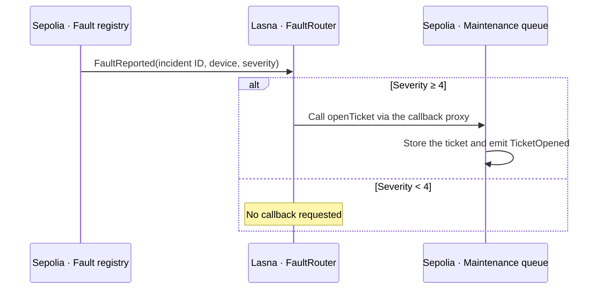

[简体中文](README.md)

# Reactive Builder Camp

This repository documents my exercises and project work from Reactive Builder Camp.

- [Exercise log](notes/README.en.md)

## Project · Equipment fault tickets

An operator reports an equipment fault on Sepolia. A Reactive contract on Lasna checks its severity and opens a ticket in the Sepolia maintenance queue when the severity is at least 4. Each incident can create only one ticket.

[Contract source](src/) · [Local tests](test/MaintenanceFlow.t.sol)

Run `git submodule update --init` and then `forge test` from the repository root. The tests simulate the Omni system contract and the callback proxy. They cover ticket creation, severity filtering, duplicate callbacks and authorisation. Testnet deployment and transaction evidence are pending.
