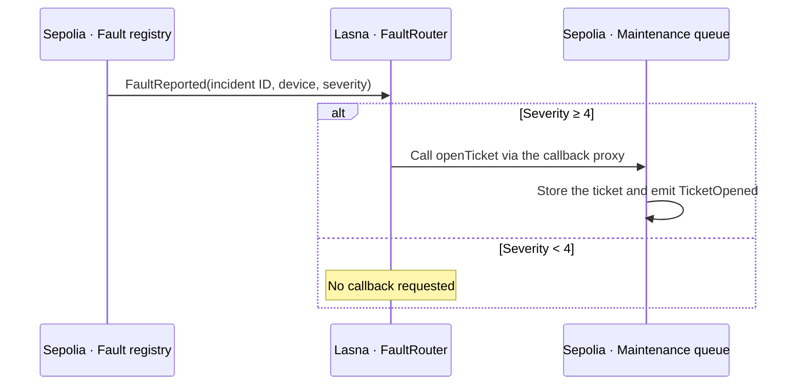

[简体中文](README.md)

# Reactive Builder Camp

This repository documents my exercises and project work from Reactive Builder Camp.

- [Exercise log](notes/README.en.md)

## Project · Equipment fault tickets

An operator reports an equipment fault on Sepolia. A Reactive contract on Lasna checks its severity and opens a ticket in the Sepolia maintenance queue when the severity is at least 4. Each incident can create only one ticket.

[Contract source](src/) · [Local tests](test/MaintenanceFlow.t.sol)

## Testnet transactions

On 24 November 2026, a severity-4 fault was reported for device `pump-17`. The destination queue stored ticket #1 with the same device and severity as the origin event.

| Step | Network | On-chain evidence |
| --- | --- | --- |
| Fault report | Ethereum Sepolia | [`FaultReported`](https://sepolia.etherscan.io/tx/0xfbf22603c1f9a1a0f699ac0525d3ef7ecec6aea7578d2e54a54c4a4e185ade68) |
| Reactive execution | Reactive Lasna | [`CallbackRequest`](https://lasna.reactscan.net/tx/0xc28ef0364026e8a16a2359bd4edb5d914b1bba5a842390c33d8335e280f6cd08) |
| Destination callback | Ethereum Sepolia | [`TicketOpened`](https://sepolia.etherscan.io/tx/0xc7831045cc6518a199fe5feff0355dd82acbc0b971c1464ff979a58ca1212902) |

Contracts: [Fault registry](https://sepolia.etherscan.io/address/0xab44eb06c59246791a1a0db6a2218848269b8c9c) · [Reactive router](https://lasna.reactscan.net/address/0x882d1234562affc23ec0e29a49492f331dce9647) · [Maintenance queue](https://sepolia.etherscan.io/address/0x0d3c80b9bd3f9cbaeed9f85b98abfc612fc83b89)

Run `git submodule update --init` and then `forge test` from the repository root. The local tests cover ticket creation, severity filtering, duplicate callbacks and authorisation.
