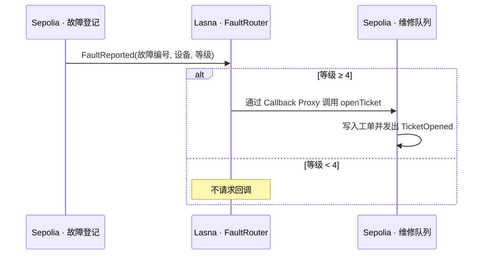

[English](README.en.md)

# Reactive Builder Camp

这里汇总我在 Reactive Builder Camp 的练习记录和项目成果。

- [练习记录](notes/)

## 项目 · 设备故障工单

运维人员在 Sepolia 登记设备故障。Lasna 上的 Reactive 合约判断故障等级，达到 4 级时在 Sepolia 的维修队列里创建一条工单。同一个故障编号只生成一条工单。

[合约源码](src/) · [本地验证](test/MaintenanceFlow.t.sol)

在仓库根目录运行 `git submodule update --init` 后执行 `forge test`。测试模拟 Omni 系统合约和回调代理，覆盖工单创建、低等级过滤、重复回调和权限校验。测试网部署及三笔交易待验证。
