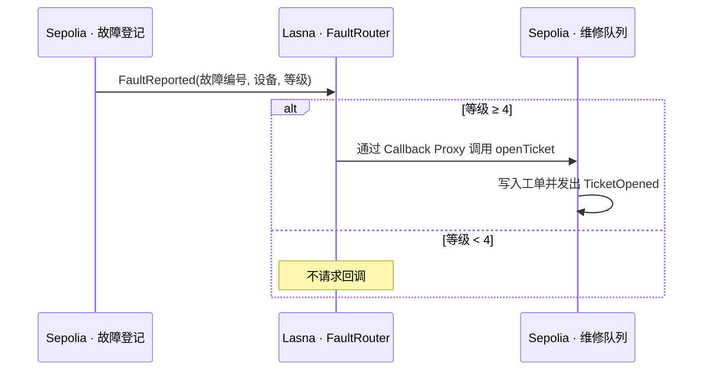

[English](README.en.md)

# Reactive Builder Camp

这里汇总我在 Reactive Builder Camp 的练习记录和项目成果。

- [练习记录](notes/)

## 项目 · 设备故障工单

运维人员在 Sepolia 登记设备故障。Lasna 上的 Reactive 合约判断故障等级，达到 4 级时在 Sepolia 的维修队列里创建一条工单。同一个故障编号只生成一条工单。

[合约源码](src/) · [本地验证](test/MaintenanceFlow.t.sol)

## 测试网交易

2026 年 11 月 24 日，上报设备 `pump-17` 的 4 级故障。目标链写入了工单 #1，记录的设备和等级与源链事件一致。

| 步骤 | 网络 | 链上记录 |
| --- | --- | --- |
| 源链上报 | Ethereum Sepolia | [`FaultReported`](https://sepolia.etherscan.io/tx/0xfbf22603c1f9a1a0f699ac0525d3ef7ecec6aea7578d2e54a54c4a4e185ade68) |
| Reactive 执行 | Reactive Lasna | [`CallbackRequest`](https://lasna.reactscan.net/tx/0xc28ef0364026e8a16a2359bd4edb5d914b1bba5a842390c33d8335e280f6cd08) |
| 目标链回调 | Ethereum Sepolia | [`TicketOpened`](https://sepolia.etherscan.io/tx/0xc7831045cc6518a199fe5feff0355dd82acbc0b971c1464ff979a58ca1212902) |

合约地址：[故障登记](https://sepolia.etherscan.io/address/0xab44eb06c59246791a1a0db6a2218848269b8c9c) · [Reactive 路由](https://lasna.reactscan.net/address/0x882d1234562affc23ec0e29a49492f331dce9647) · [维修队列](https://sepolia.etherscan.io/address/0x0d3c80b9bd3f9cbaeed9f85b98abfc612fc83b89)

在仓库根目录运行 `git submodule update --init` 后执行 `forge test`。本地测试覆盖工单创建、低等级过滤、重复回调和权限校验。
